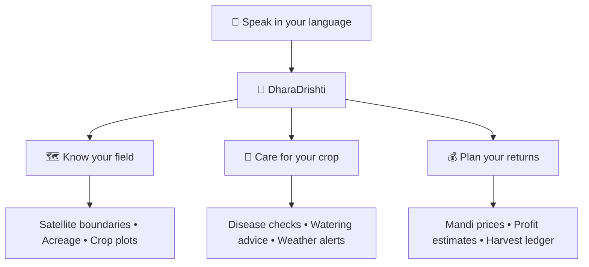

<div align="center">

# 🌾 DharaDrishti · धरादृष्टि
### Vision of the Earth. A Voice for Every Farmer.

**Your field. Your language. Your farming companion.**

Voice-first, field-specific guidance for Indian farmers — from sowing decisions to harvest records.

🗣️ **10 Languages** · 🛰️ **Satellite Mapping** · 🌱 **Smarter Farm Decisions**

</div>

---

## 🌱 Farming Guidance, Just a Conversation Away

Technology should feel as familiar as talking to a neighbour.

DharaDrishti brings crop care, weather insights, and farm planning together in a voice-accessible platform designed for farmers with limited literacy or technical experience.

> 🎤 **“खेत दिखाओ”** → View your fields  
> 💧 **“क्या पानी दूं?”** → Get irrigation advice  
> 🔬 **“पत्ती जांचो”** → Start a leaf inspection  
> 🌾 **“२५ क्विंटल गेहूं काटा”** → Record your harvest  

## 🌻 From Field to Harvest



| | Feature | What it helps you do |
|---|---|---|
| 🗺️ | **My Fields** | Map boundaries by GPS or satellite, calculate acreage, and manage crop plots. |
| 🔬 | **Crop Doctor** | Inspect leaf photos for disease, review severity, and explore remedies with KVK escalation. |
| 💧 | **Water & Nutrients** | Plan irrigation around weather and estimate fertiliser needs using soil NPK values. |
| 💰 | **Mandi & Margins** | Compare market prices and explore low, expected, and high net-profit estimates. |
| ⛅ | **Weather Watch** | Check a 7-day forecast and plan watering or spraying around conditions. |
| 📊 | **Fasal Score** | Track farm health with a transparent 0–100 score and record harvests by voice. |
| 💬 | **Kisan AI** | Ask farm-specific questions with ICAR/KVK-backed guidance. |

## 🗣️ Many Languages. One Shared Ground.

**हिन्दी** · English · ਪੰਜਾਬੀ · தமிழ் · తెలుగు  
मराठी · ગુજરાતી · বাংলা · ಕನ್ನಡ · മലയാളം

Hindi is the default language, with voice input and spoken responses supporting the farmer’s chosen language.

## 🎨 Colours Rooted in the Land

| 🌲 Forest | 🌿 Leaf | 🌾 Wheat | 🌅 Harvest |
|:---:|:---:|:---:|:---:|
| `#186049` | `#4A943E` | `#ECE8AF` | `#B98327` |

## 🛠️ Built With

**Next.js 14+** · **Tailwind CSS** · **Leaflet** · **Esri World Imagery**  
**Web Speech API** · **Geodesic Shoelace & Haversine** · **Canvas Confetti**

## 🚀 Plant the First Seed

```bash
# Install dependencies
npm install

# Start development
npm run dev
```

Visit [localhost:3000](http://localhost:3000).

```bash
# Build and run for production
npm run build
npm start
```

## 📄 License

MIT License · Built for a hackathon, inspired by Indian agriculture.

---

<div align="center">

**धरती की समझ, किसान की आवाज़।**  
*Understanding the land. Amplifying the farmer’s voice.*

</div>
